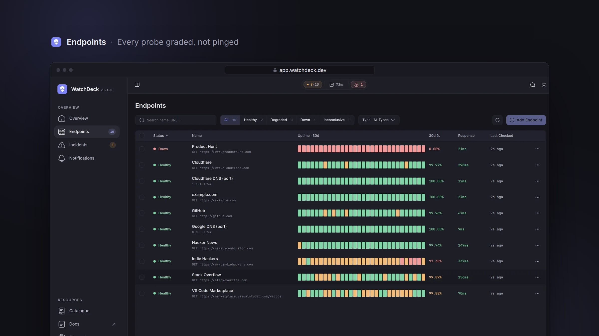
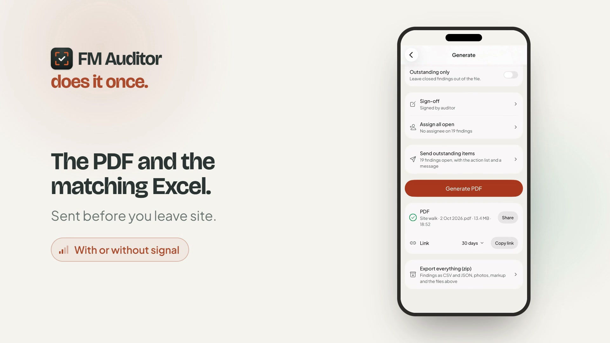
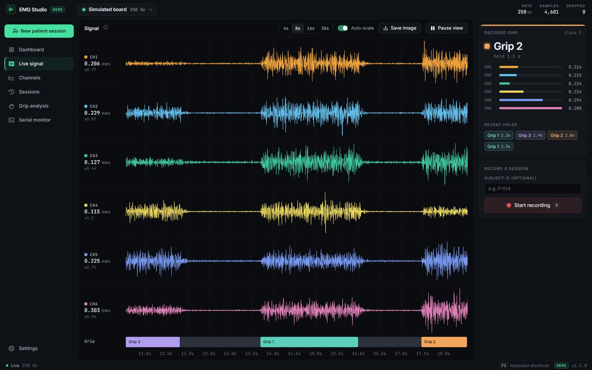
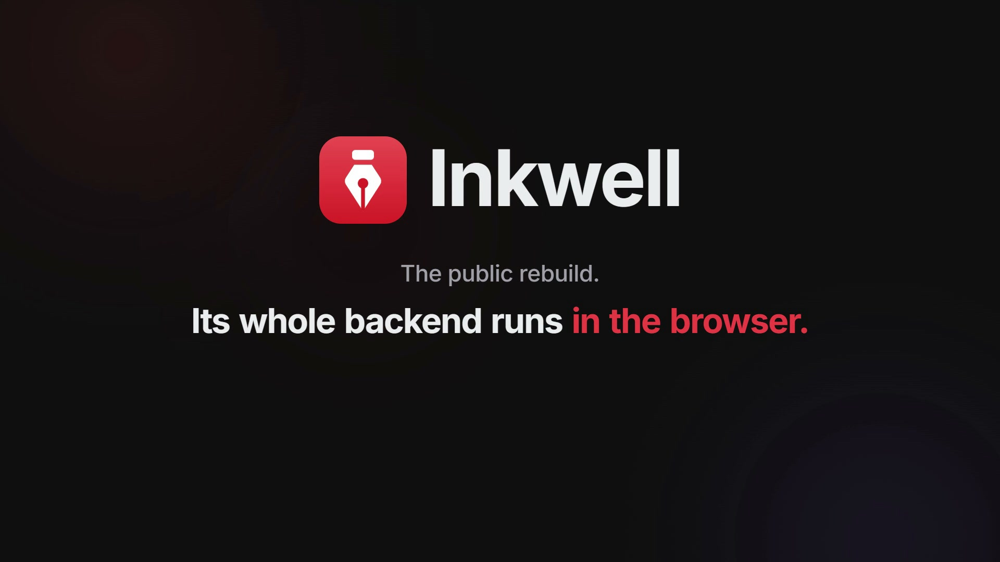

<!-- ======================= HEADER ======================= -->

<h1 align="center">Hi, I'm Alexander Smith 👋</h1>

<p align="center">
  <b>Creative web designer &amp; developer</b>, working independently from Dubai.<br />
  <samp>Real-time 3D · WebGL · motion · full-stack, from the first sketch to the day it goes live.</samp>
</p>

<p align="center">
  <a href="https://www.alexandersmith.dev" target="_blank"></a>
  <a href="https://www.linkedin.com/in/alex-smith-dev/" target="_blank"></a>
  <a href="mailto:ajs@alexandersmith.dev"></a>
  <a href="https://www.alexandersmith.dev/contact" target="_blank"></a>
</p>

<p align="center">
  
</p>

---

<!-- ======================= INTRO ======================= -->

Most people build interfaces. I try to build **atmosphere**: sites with 3D, motion and sound that run live in the browser instead of being played back as video. I do all of it myself, including the art direction, the shaders, the backend and the launch, so nothing gets lost in a handover.

Most of what I build is one of these:

- 🌌 **Immersive brand sites.** Flagship sites with 3D, motion and sound, made to feel expensive before anybody reads a word.
- 🚀 **Product & launch experiences.** Campaign sites, product reveals and configurators, built to survive launch-day traffic.
- 🧊 **Real-time 3D & WebGL.** Custom GLSL shaders, GPU particles and tuned render loops that hold 60 fps on an ordinary laptop.
- 🧱 **Full-stack products.** Next.js, TypeScript and Node, with fast and accessible pages and a CMS people can actually use.

> 👇 Or say hi from your terminal:
>
> ```bash
> npx alexsmith
> ```
>
> <sub>That's my command-line business card. The source is in <a href="https://github.com/alexsmith2910/npx_alexsmith_cli">npx_alexsmith_cli</a>.</sub>

---

<!-- ======================= SELECTED WORK ======================= -->

### ✨ Selected work

<table width="100%">
  <tr>
    <td width="50%" valign="top">
      <a href="https://www.alexandersmith.dev/work/watchdeck-cloud"></a>
      <h4>🛰️ WatchDeck Cloud <sub><code>2026</code></sub></h4>
      <p>A hosted uptime platform that runs deep checks against live endpoints. It has a multi-tenant dashboard, an incident pipeline and a private status API. I designed, built and documented it myself.</p>
      <p><sub><code>Next.js 16</code> <code>React 19</code> <code>TypeScript</code> <code>Supabase</code> <code>Vercel Cron</code> <code>HeroUI</code></sub></p>
      <p>
        <a href="https://app.watchdeck.dev/">Live app ↗</a> ·
        <a href="https://www.alexandersmith.dev/work/watchdeck-cloud">Case study ↗</a> ·
        <a href="https://github.com/alexsmith2910/WatchDeck">Open-source core ↗</a>
      </p>
    </td>
    <td width="50%" valign="top">
      <a href="https://www.alexandersmith.dev/work/fm-auditor"></a>
      <h4>📋 FM Auditor <sub><code>2026</code></sub></h4>
      <p>An iPhone app that turns a facilities site walk into the finished report. It works offline: photos, dictated remarks and map pins go in, and a PDF plus a matching Excel workbook come out before you leave site.</p>
      <p><sub><code>Expo</code> <code>React Native</code> <code>TypeScript</code> <code>SQLite</code> <code>Drizzle</code> <code>Supabase</code> <code>Skia</code></sub></p>
      <p>
        <a href="https://fmauditor.app/">fmauditor.app ↗</a> ·
        <a href="https://www.alexandersmith.dev/work/fm-auditor">Case study ↗</a>
      </p>
    </td>
  </tr>
  <tr>
    <td width="50%" valign="top">
      <a href="https://www.alexandersmith.dev/work/symbionic"></a>
      <h4>🦾 Symbionic EMG Studio <sub><code>2023 → 2026</code></sub></h4>
      <p>A Windows workstation that clinicians use to calibrate a bionic arm to a patient's muscle signals. I rebuilt it from my internship prototype and added a built-in board simulator.</p>
      <p><sub><code>Electron</code> <code>React</code> <code>TypeScript</code> <code>zustand</code> <code>uPlot</code> <code>serialport</code> <code>Playwright</code></sub></p>
      <p>
        <a href="https://www.alexandersmith.dev/download/symbionic">Download ↗</a> ·
        <a href="https://www.alexandersmith.dev/work/symbionic">Case study ↗</a>
      </p>
    </td>
    <td width="50%" valign="top">
      <a href="https://www.alexandersmith.dev/work/inkwell"></a>
      <h4>🖋️ Inkwell <sub><code>2025 → 2026</code></sub></h4>
      <p>A comics reading platform I originally built for a client. I later rebuilt it as a public demo whose whole backend runs in the browser, with no server and no database.</p>
      <p><sub><code>React</code> <code>TypeScript</code> <code>Vite</code> <code>Express</code> <code>MongoDB</code> <code>Strapi</code> <code>Docker</code></sub></p>
      <p>
        <a href="https://inkwell.alexsmiths.com/">Live demo ↗</a> ·
        <a href="https://www.alexandersmith.dev/work/inkwell">Case study ↗</a>
      </p>
    </td>
  </tr>
</table>

---

<!-- ======================= LAB ======================= -->

### 🧪 From the Lab

These are short write-ups of techniques I built for [alexandersmith.dev](https://www.alexandersmith.dev/lab), each with the code that runs them. Most are running live on the site right now.

| | Entry | What it's about |
|:-:|:--|:--|
| 📐 | [**Fit**](https://www.alexandersmith.dev/lab/fit) | Framing a 3D room in any viewport with an orthographic camera: two zooms, and the stricter one wins |
| 📜 | [**Scrub**](https://www.alexandersmith.dev/lab/scrub) | Text that scroll *plays* rather than triggers, inked in word by word with GSAP |
| 🧲 | [**Magnet**](https://www.alexandersmith.dev/lab/magnet) | Buttons that lean towards the cursor and feel weighted rather than jittery |
| 🐝 | [**Swarm**](https://www.alexandersmith.dev/lab/swarm) | Packets crawling along a cable for one draw call, using an InstancedMesh and a Catmull-Rom curve |
| 🔳 | [**Halftone**](https://www.alexandersmith.dev/lab/halftone) | A dissolve made of grain instead of an edge, written as a fragment shader |
| ☕ | [**Plume**](https://www.alexandersmith.dev/lab/plume) | Coffee steam from one folded quad and scrolling noise, without a single particle |

<p align="center"><a href="https://www.alexandersmith.dev/lab"><b>Read all Lab entries →</b></a></p>

---

<!-- ======================= ABOUT ======================= -->

### 🧑‍💻 A little more about me

```javascript
const alexander = {
  role: "Independent creative web designer & developer",
  basedIn: "Dubai 🇦🇪 (originally from the UK 🇬🇧)",
  code: ["TypeScript", "JavaScript", "GLSL", "Python", "Java"],
  stack: {
    frontEnd: ["React", "Next.js", "Astro", "Tailwind"],
    graphics: ["Three.js", "WebGL", "GLSL", "GSAP", "Lenis"],
    backEnd: ["Node", "Express", "Postgres", "Supabase", "Headless CMS"],
    apps: ["Expo / React Native", "Electron"],
    craft: ["Figma", "Blender", "Motion", "Sound"],
  },
  currently: {
    building: "A real-time configurator for a product launch",
    learning: "Compute shaders & WebGPU",
    openTo: "New projects",
  },
  askMeAbout: ["WebGL (for hours)", "shaders", "web dev", "app dev", "horses"],
  offTheClock: ["Running 🏃 (the best ideas arrive around km 4)", "Collecting obscure typefaces", "One too many side projects"],
  funFact: "There are two ways to write error-free programs; only the third one works",
};
```

---

<!-- ======================= SKILLS ======================= -->

### 🛠️ Toolkit

**Languages**


**Graphics & motion**


**Frontend**


**Apps**


**Backend & data**


**Platforms & tooling**


---

<!-- ======================= OPEN SOURCE ======================= -->

### 📦 On GitHub

<table width="100%">
  <tr>
    <td width="50%" valign="top">
      <b>🛰️ <a href="https://github.com/alexsmith2910/WatchDeck">WatchDeck</a></b><br />
      <sub>The self-hosted endpoint-monitoring toolkit behind WatchDeck Cloud, shipped as an npm package.</sub><br />
      <sub><code>TypeScript · MIT</code></sub>
    </td>
    <td width="50%" valign="top">
      <b>📇 <a href="https://github.com/alexsmith2910/npx_alexsmith_cli">npx alexsmith</a></b><br />
      <sub>An interactive command-line business card. Run <code>npx alexsmith</code> to say hi.</sub><br />
      <sub><code>JavaScript · MIT</code></sub>
    </td>
  </tr>
  <tr>
    <td width="50%" valign="top">
      <b>🗺️ <a href="https://github.com/alexsmith2910/PathFindingApp">Path Finding App</a></b><br />
      <sub>Dijkstra and A* pathfinding over a realistic map-style view, plotting the quickest route.</sub><br />
      <sub><code>Python</code></sub>
    </td>
    <td width="50%" valign="top">
      <b>♻️ <a href="https://github.com/alexsmith2910/recycled-products-ltd">Recycled Products Ltd</a></b><br />
      <sub>A TypeScript web application backed by PostgreSQL.</sub><br />
      <sub><code>TypeScript · PostgreSQL</code></sub>
    </td>
  </tr>
  <tr>
    <td width="50%" valign="top">
      <b>📈 <a href="https://github.com/alexsmith2910/Cryptocurrency-Trading-Bot">Cryptocurrency Trading Bot</a></b><br />
      <sub>An experimental crypto trading bot.</sub><br />
      <sub><code>Python</code></sub>
    </td>
    <td width="50%" valign="top">
      <b>🤖 <a href="https://github.com/alexsmith2910/DigitalMinerDiscordBot">Digital Miner Discord Bot</a></b><br />
      <sub>A Discord bot for a mining-themed community game.</sub><br />
      <sub><code>JavaScript · MIT</code></sub>
    </td>
  </tr>
</table>

<p align="center">
  <a href="https://github.com/alexsmith2910?tab=repositories"></a>
</p>

---

<p align="center">
  <b>Got something in mind?</b> A brand world, a launch, or something that doesn't have a name yet.<br />
  <a href="https://www.alexandersmith.dev/contact"><b>Start a project →</b></a>
</p>
